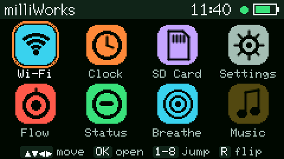
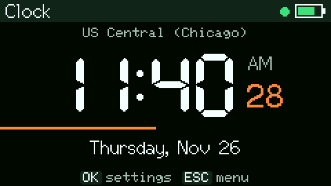
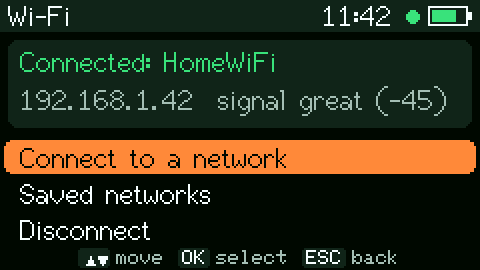
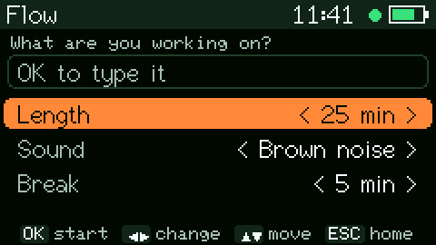
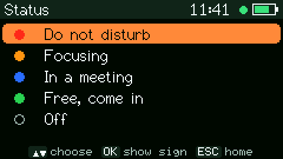
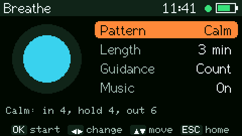
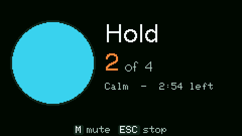
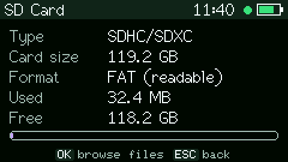
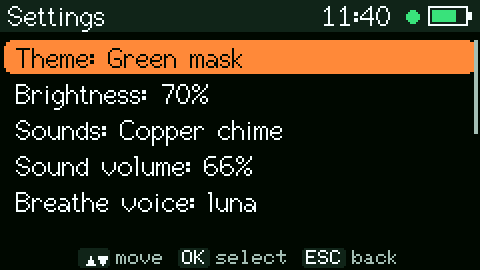
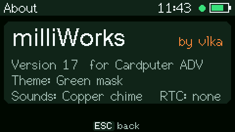

# milliWorks for the M5Stack Cardputer ADV

*By [vlkadusumilli](https://github.com/vlkadusumilli) (vlka)*

A small, friendly set of apps for the **M5Stack Cardputer ADV**: a clock that keeps time
without waiting for the internet, a focus timer with calming sounds, a status light for
"do not disturb", and a guided breathing app with a voice that counts with you.

<p align="center"></p>

The home screen: pick an app with the arrow keys, or press its number (1–8).

## The apps

<table>
<tr>
<td width="50%"></td>
<td><b>Clock</b><br>Big, easy-to-read time and date. It shows the last known time the moment you
switch on, then corrects itself from the internet (NTP). Choose your time zone and 12/24-hour
format, or set the time by hand. An RTC module on the Grove port keeps time with the power off.</td>
</tr>
<tr>
<td></td>
<td><b>Wi-Fi</b><br>Scan and join networks. The password is shown while you type, so typos are
easy to spot (Tab hides it). Remembers up to 5 networks and reconnects to the last one quickly
at start-up.</td>
</tr>
<tr>
<td></td>
<td><b>Flow</b><br>A focus timer. Write what you're working on, choose a length, a background
sound (rain, brown noise, drone, tick) and a break. During the session you can park a
distracting thought for later, switch or mute the sound, and see a summary at the end. Parked
thoughts are saved to the SD card.</td>
</tr>
<tr>
<td></td>
<td><b>Status</b><br>Turns the Cardputer into a sign for people around you: <i>Do not disturb</i>,
<i>Focusing</i>, <i>In a meeting</i> or <i>Free, come in</i>, shown on the screen and by the colour of
the RGB LED.</td>
</tr>
<tr>
<td></td>
<td><b>Breathe</b><br>Guided breathing with four patterns: Calm (4-4-6), Box (4-4-4-4), 4-7-8 and
Even (5-5). Choose the length, calm background music, and how you're guided: <b>Count</b>
(a voice says <i>In / Hold / Out</i> and counts each second), Voice, Tones, or Silent. Made
for eyes-closed use.</td>
</tr>
<tr>
<td></td>
<td><b>Breathe, during a session</b><br>The circle grows as you breathe in and shrinks as you
breathe out, and the LED glows with it. The number on screen is the same number the voice says.
Press M to mute the music.</td>
</tr>
<tr>
<td></td>
<td><b>SD Card</b><br>What card is inserted, how full it is, and a file browser.</td>
</tr>
<tr>
<td></td>
<td><b>Settings</b><br>Six themes, each with its own sound pack. Also brightness, sound volume,
the Breathe voice, flip screen, the welcome tour, and the keyboard bridge for the simulator.
<b>Save settings to SD card</b> lets you move your setup to another Cardputer.</td>
</tr>
<tr>
<td></td>
<td><b>About</b><br>Version, theme, sound pack and whether an RTC module is fitted.</td>
</tr>
</table>

The Music app is coming. Screenshots are from the Mac simulator running the real firmware,
so they match the device pixel for pixel.

## Install

You need a Cardputer **ADV** with a microSD card (FAT32).

### 1. The firmware

The easiest way is **[Launcher](https://bmorcelli.github.io/Launcher/webflasher.html)**,
which lets you keep several firmwares on the Cardputer and switch between them.

1. Download `milliworks-cardputer-adv-vXX.bin` from the [latest release](../../releases/latest).
2. Copy it to the `bins` folder on the SD card. Use a card reader, or Launcher's **WUI** (web page) over Wi-Fi.
3. On the Cardputer, open Launcher → **SD** → `bins` → the `.bin` → **Install**.

When updating, first remove the old version in Launcher's **PM** (partition manager), then
choose **Apply Changes**. Launcher keeps each installed version in its own slot.

### 2. The voices (for Breathe)

1. Download `milliWorks-sd-card.zip` from the same release and unzip it.
2. Copy the `milliWorks` folder to the top level of the SD card. It holds `milliWorks/breathe/voices/luna` and `julian`.
   - If milliWorks has already started with the card inserted, the folders are already there. Copy the `luna` and `julian` folders into `milliWorks/breathe/voices/`.
3. On the Cardputer: **Settings → Breathe voice**, then pick **luna** (female) or **julian** (male).

There's also a small voice built into the firmware, so Breathe works without the card. It
doesn't count, though.

### What's on the SD card

milliWorks keeps everything in one folder and creates it when it starts:

```
/milliWorks/settings/settings.json     Settings → Save settings to SD card
/milliWorks/breathe/voices/<name>/     in.wav, hold.wav, out.wav, 2.wav … 8.wav
/milliWorks/flow/parked.txt            thoughts you parked during Flow
/milliWorks/music/                     for the Music app (coming)
```

`settings.json` lets you move your setup to another Cardputer. Wi-Fi passwords are only
included if you say yes when saving.

### Your own voice

A voice is a folder with 16-bit WAV files: `in.wav`, `hold.wav`, `out.wav` and `2.wav` to
`8.wav`. Each clip must be under 1 second, or it runs into the next count. Record your own
clips, then tidy them (trim, fade, even loudness) with:

```bash
python3 tools/import_voice.py myvoice in=in.wav hold=hold.wav out=out.wav 2=two.wav 3=three.wav
swiftc -O tools/check_voice.swift -o /tmp/check_voice && /tmp/check_voice myvoice   # does each clip say the right word?
```

## Keys

| Key | In menus | While typing text |
|---|---|---|
| `;` `.` `,` `/` | up, down, left, right | Fn + the key |
| `` ` `` (Esc) | back | Fn + `` ` `` |
| Del | back | delete a letter |
| Enter | OK | OK |
| G0 (top button) | stops the keyboard bridge | |

## Make it yours (template)

This repository is a **template**. Click **Use this template** at the top of the GitHub
page to get your own copy, then:

**Rename it.** Everything that carries the name lives in [`src/config.h`](src/config.h):

```cpp
#define FW_NAME    "milliWorks"     // start-up screen, welcome tour, settings file
#define FW_VERSION "17"
#define MW_DIR     "/milliWorks"    // the app's folder on the SD card
#define PREFS_NS   "cardputer"      // where settings are kept in flash
```

**Add an app.** An app is a function that draws its screen and runs until you press Back:

```cpp
// src/app_hello.cpp
#include "ui.h"
#include "apps.h"

void appHello() {
    while (true) {
        M5Cardputer.update();
        Input in = readInput();              // keys, with the theme's key sounds
        if (in.back) return;                 // ` or Del goes back to the home screen
        drawHeader("Hello");                 // title bar with clock and battery
        canvas.setFont(&fonts::Font4);
        canvas.setTextColor(col::accent);    // theme colours: col::text, dim, accent, good, warn...
        canvas.setTextDatum(middle_center);
        canvas.drawString("Hi there!", SCREEN_W / 2, 70);
        drawHints({{"ESC", "back"}});
        pushScreen();                        // everything is drawn off-screen, then shown at once
    }
}
```

Then declare it in [`src/apps.h`](src/apps.h) (`void appHello();`) and add it to the home
screen's `APPS` list in [`src/main.cpp`](src/main.cpp), with a colour and an icon. Icons
are drawn in `drawGlyph`, so reuse one or add your own.

**Helpers you get** (see [`src/ui.h`](src/ui.h)): `toast`, `confirm`, `pickFromList`,
`textPrompt` (with a show/hide for passwords), `drawTextFit` (shrinks text to fit), six
themes with matching sounds (`playSfx`), Wi-Fi, NTP time, the SD card (`sdMount`) and the
LED (`status.h`). Try every change in the Mac simulator before putting it on the device.

**Space.** Launcher gives each firmware a slot rounded up to 64 KB. milliWorks v17 is
1086 KB, which fits a 1088 KB slot; going over moves it to the next size up.

## Build it yourself

[PlatformIO](https://platformio.org):

```bash
pio run -e cardputer-adv                       # build
pio run -e cardputer-adv -t upload             # flash over USB (needs upload_flags = --no-stub, already set)
```

### Mac simulator

The `sim` folder runs the real firmware in a window on a Mac, using the same screen library.
It has the same colours, a working keyboard, sound, and a pretend SD card and Wi-Fi.

```bash
brew install sdl2
make -C sim run          # as your Cardputer is now
make -C sim run-new      # like a brand-new one (welcome tour)
make -C sim run-keys     # type on the real Cardputer: Settings → Keyboard bridge on it
```

### Checks

```bash
c++ -std=c++17 -O2 -I src tools/render_sounds.cpp -o /tmp/rs && /tmp/rs        # every sound: level, clicks, length
c++ -std=c++17 -O2 -I src tools/test_sd_features.cpp -o /tmp/sd && /tmp/sd     # settings file + voice loading
```

## License

[Apache License 2.0](LICENSE). Use, change and share milliWorks freely, including in your
own projects and products. When you fork or redistribute it, you must:

- keep the [`NOTICE`](NOTICE) file, which credits **vlkadusumilli** as the original author, and the copyright lines;
- mark the files you changed;
- include the license.

The About screen's "by vlka" credit (`FW_AUTHOR` in `config.h`) is part of that attribution.
Keep it, or add your name next to it.

## Credits

- milliWorks is created by [vlkadusumilli](https://github.com/vlkadusumilli).

- Built on [M5Unified](https://github.com/m5stack/M5Unified), [M5GFX](https://github.com/m5stack/M5GFX) and [M5Cardputer](https://github.com/m5stack/M5Cardputer).
- Voices Luna and Julian were generated with Seed Audio (ByteDance) through Higgsfield.
- Installed with [Launcher](https://github.com/bmorcelli/Launcher) by bmorcelli.
